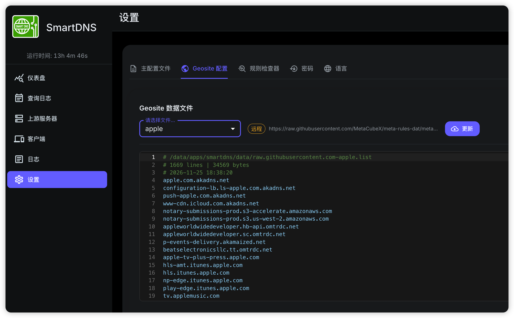
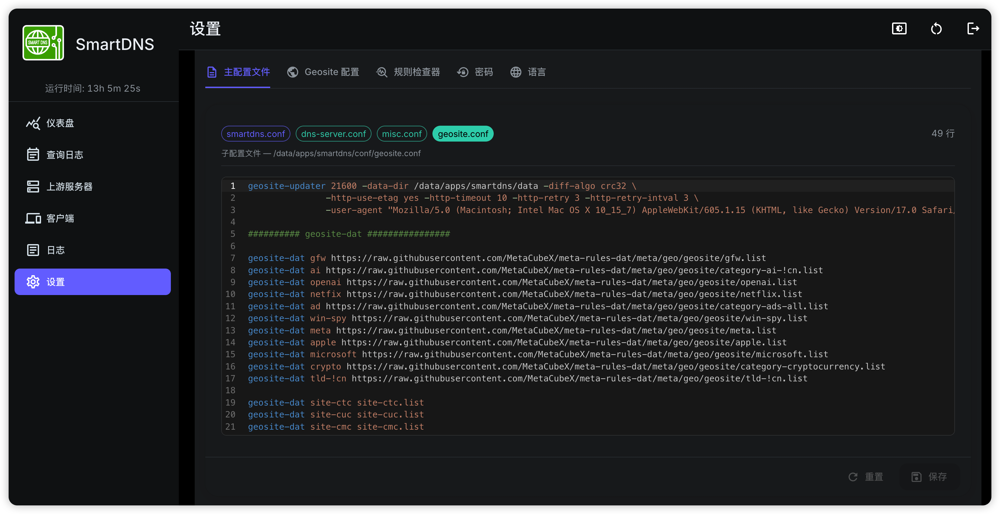
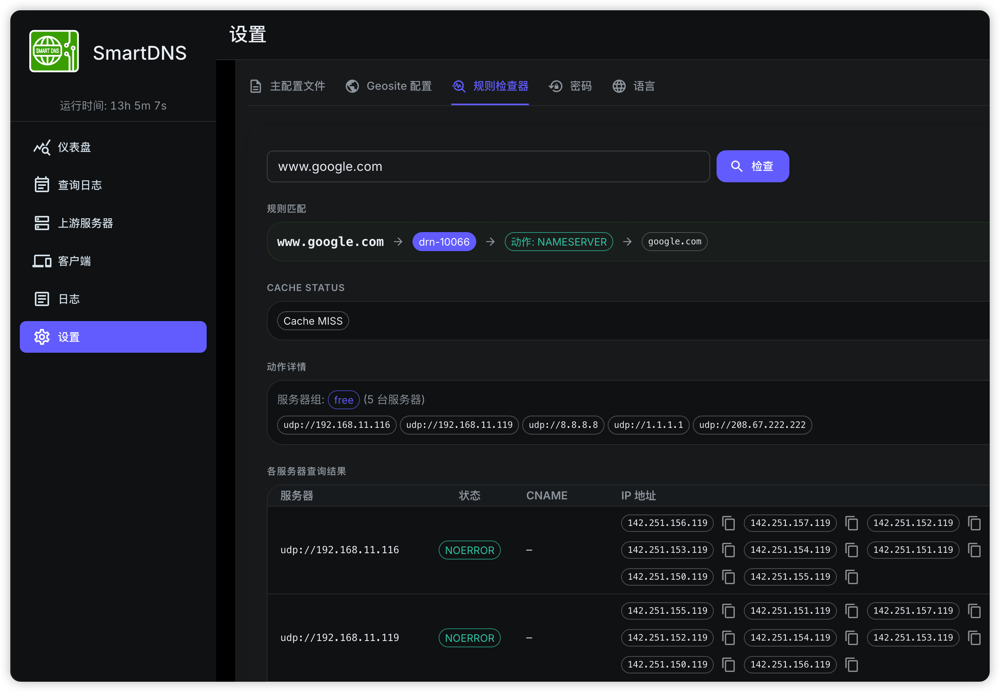
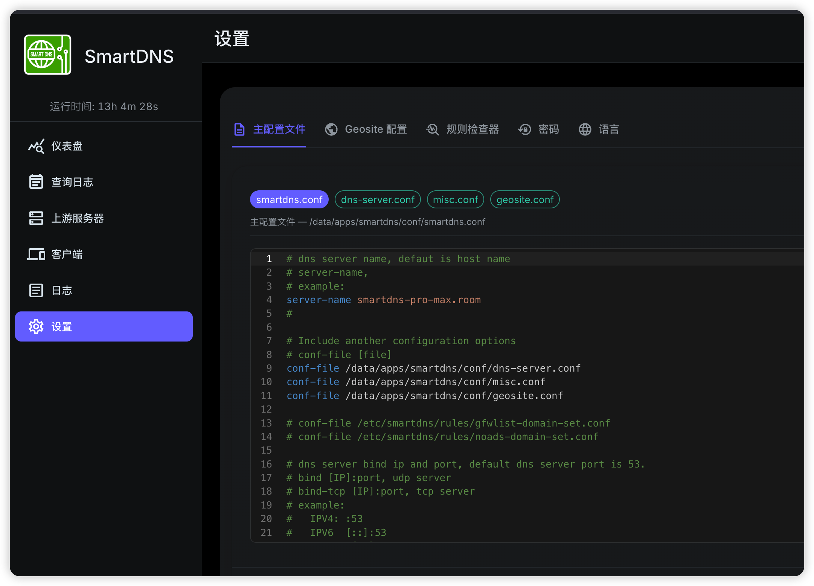

# SmartDNS Pro Max

**[EN](ReadMe_en.md)**

**基于 [pymumu/smartdns](https://github.com/pymumu/smartdns) 的增强分支** — 在上游高速 DNS 分流解析能力之上，补齐 geosite 域名分流的完整管理闭环，并提供全新的规则链诊断工具。

<p align="center"></p>

SmartDNS 是一个运行在本地的 DNS 服务器，接受本地客户端的 DNS 查询请求，从多个上游 DNS 服务器获取结果，并将访问速度最快的 IP 返回给客户端。同时支持指定特定域名 IP 地址实现广告过滤，支持 DOT / DOH / DOQ / DOH3 保护隐私。

本分支在此之上新增的核心能力：

| 特性 | 说明 |
| --- | --- |
| **Geosite 域名分流** | 完整支持 `geosite-dat` 域名列表：自动下载、变更检测、热重载、WebUI 管理 |
| **规则链诊断** | 独创 `--check-domain-rule` CLI 与 WebUI 规则检查器，一眼看清域名命中哪条规则、走了哪台服务器 |
| **配置在线编辑** | WebUI 直接编辑主配置与子配置文件，支持多文件切换 |
| **稳定性增强** | 修复 TCP ping use-after-free、fast_ping 竞态、geosite reload 崩溃等真实崩溃问题 |
| **Docker 多架构** | 重构构建管线，提供 amd64 / arm64 运行镜像与开发调试镜像 |

---

## 特色功能

### 1. Geosite 域名分流

通过 `geosite-dat` 指令引入域名列表文件（本地 list 或远程 URL），按主题分组分流：

```conf
# 子配置 geosite.conf
geosite-updater 21600 --data-dir /data/apps/smartdns/data --diff-algo crc32 \
    --http-use-etag yes --http-timeout 10 --http-retry 3 --http-retry-interval 3

geosite-dat gfw      https://raw.githubusercontent.com/MetaCubeX/meta-rules-dat/meta/geo/geosite/gfw.list
geosite-dat netflix  https://raw.githubusercontent.com/MetaCubeX/meta-rules-dat/meta/geo/geosite/netflix.list
geosite-dat openai   https://raw.githubusercontent.com/MetaCubeX/meta-rules-dat/meta/geo/geosite/openai.list
geosite-dat ads      https://raw.githubusercontent.com/MetaCubeX/meta-rules-dat/meta/geo/geosite/category-ads-all.list
geosite-dat apple    https://raw.githubusercontent.com/MetaCubeX/meta-rules-dat/meta/geo/geosite/apple.list
geosite-dat site-ctc site-ctc.list
```

- **自动更新**：`geosite-updater` 周期性下载远程列表，基于 ETag / mtime / crc32 / md5 做变更检测，内容无变化时自动跳过重载
- **热重载**：列表文件变更后无需重启服务，规则即时生效
- **子配置感知**：主配置与 `conf-file` 引入的子配置中的 geosite 指令统一生效
- **WebUI 管理**：可视化选择、查看每个 geosite 数据文件的内容、行数与更新时间



主配置文件编辑器中的 geosite 配置示例：



### 2. 规则链诊断（规则检查器）

排障时最常问的问题——"这个域名为什么走了这条分流？"——现在有了直接答案。

**CLI 方式**（输出 JSON，便于脚本化）：

```shell
/usr/sbin/smartdns --check-domain-rule www.google.com -c /etc/smartdns/smartdns.conf
```

**WebUI 方式**：在「设置 → 规则检查器」中输入域名，即可看到完整的规则匹配链：

- 命中的规则 ID 与动作（NAMESERVER / IPSET / NFTSET 等）
- Cache 状态（HIT / MISS）
- 服务器组与组内全部上游服务器
- 每台服务器的真实查询结果：状态码、CNAME 链、返回的 IP 列表
- 支持解析结果按 `response-mode` 展示（FIRST_PING_IP / FASTEST_RESPONSE），完整支持 IPv6 服务器



### 3. WebUI 配置在线编辑

仪表盘、查询日志、上游服务器之外，新增设置页的配置文件编辑器：`smartdns.conf`、`dns-server.conf`、`misc.conf`、`geosite.conf` 多文件切换编辑，保存即时生效。



### 4. 稳定性修复

本分支修复了多处上游存在的崩溃与竞态问题：

- **TCP ping use-after-free**：`speed-check-mode` 使用 `tcp:443` 测速时可能触发 UAF 崩溃，已修复并调整默认测速策略
- **fast_ping 竞态**：ping 关闭通知与事件排空的竞态条件修复
- **geosite reload 崩溃**：配置重载时 `getopt_long_only` 重排 argv 导致的重放异常，已通过参数拷贝保护修复
- **HTTP/2 内存安全**：合入并跟进上游 HPACK / HTTP2 流相关 UAF 修复

### 5. Docker 多架构构建

- `amd64` / `arm64` 双架构运行镜像与构建镜像
- `smartdns-dev` 开发调试镜像（内置 gdb、strace、vim）
- 支持通过 `LOCAL_DEPS_PREFIX`（如 `/opt`）注入自定义依赖
- OpenSSL / Curl 静态链接构建，插件静态 release 支持

---

## 上游核心特性

以下能力继承自上游 [pymumu/smartdns](https://github.com/pymumu/smartdns)：

- **多虚拟 DNS 服务器**：不同端口、规则、客户端独立控制
- **多上游并发查询**：单点故障不影响解析
- **返回最快 IP**：从解析结果中测速并返回访问最快的地址
- **多协议**：UDP / TCP / DOT / DOH / DOQ / DOH3，非 53 端口，socks5 / HTTP 代理
- **域名高性能后缀匹配**：20 万条记录过滤 < 1ms
- **域名分流**：不同域名走不同上游，支持 ipset / nftset（本分支增强为每个域名多个目标）
- **客户端独立控制**：基于 MAC / IP 的家长控制
- **IPv4 / IPv6 双栈**、**DNS64**
- **多平台**：树莓派、OpenWrt、华硕路由器、WSL

## 架构

<p align="center"></p>

1. SmartDNS 接收本地网络设备（PC、手机）的 DNS 查询请求；
2. 将查询请求发送到多个上游 DNS 服务器（含 geosite 分流选路）；
3. 上游返回 IP 列表后，SmartDNS 检测本地访问速度最快的服务器 IP；
4. 将最快 IP 返回给本地客户端。

## 编译

**本地编译**：

```shell
make
```

**Docker 构建**（推荐，多架构）：

```shell
# amd64
docker build -t smartdns:amd64 .

# arm64
docker build -f Dockerfile.arm64 -t smartdns:arm64 .
```

SmartDNS 同样提供编译脚本（`package/build-pkg.sh`），支持 LuCI、Debian、OpenWrt 和 Optware 安装包。

**WebUI**：本分支配套的 WebUI 前端见独立仓库 [onion83/smartdns-webui](https://github.com/onion83/smartdns-webui)，插件形态源码见 [smartdns-ui 插件](plugin/smartdns-ui/)，基于 Next.js 构建（`npm run build`）。

## 上游使用文档

完整配置文档请参考上游官网：[https://pymumu.github.io/smartdns](https://pymumu.github.io/smartdns)

## 致谢与捐赠

本项目基于上游 [pymumu/smartdns](https://github.com/pymumu/smartdns) 开发，感谢原作者 [@nickpeng](https://github.com/pymumu) 及所有上游贡献者的工作。

## 开源声明

SmartDNS 基于 GPL V3 协议开源。
