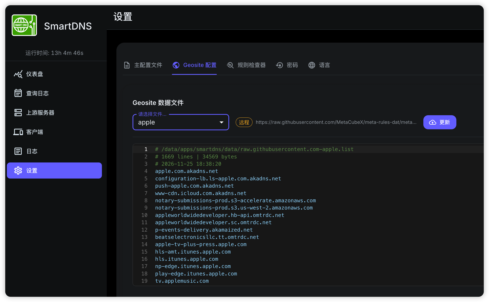
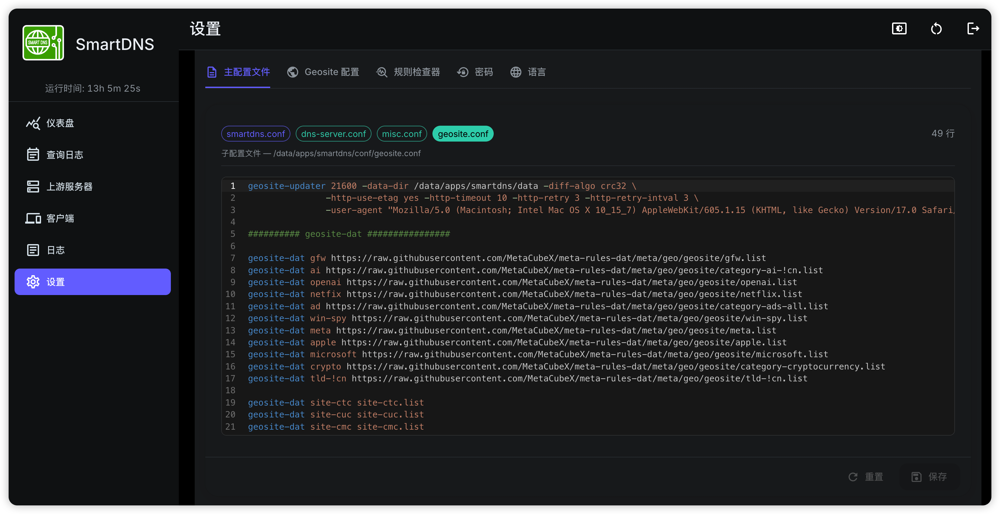
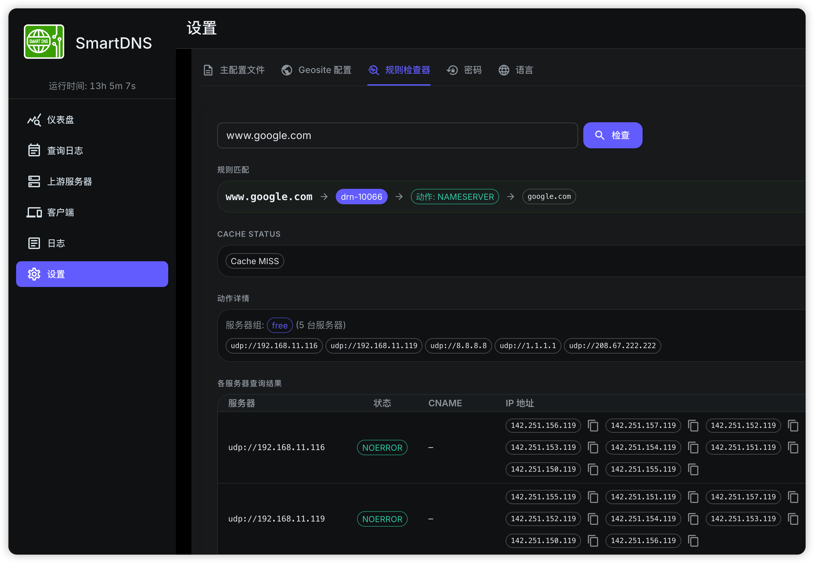
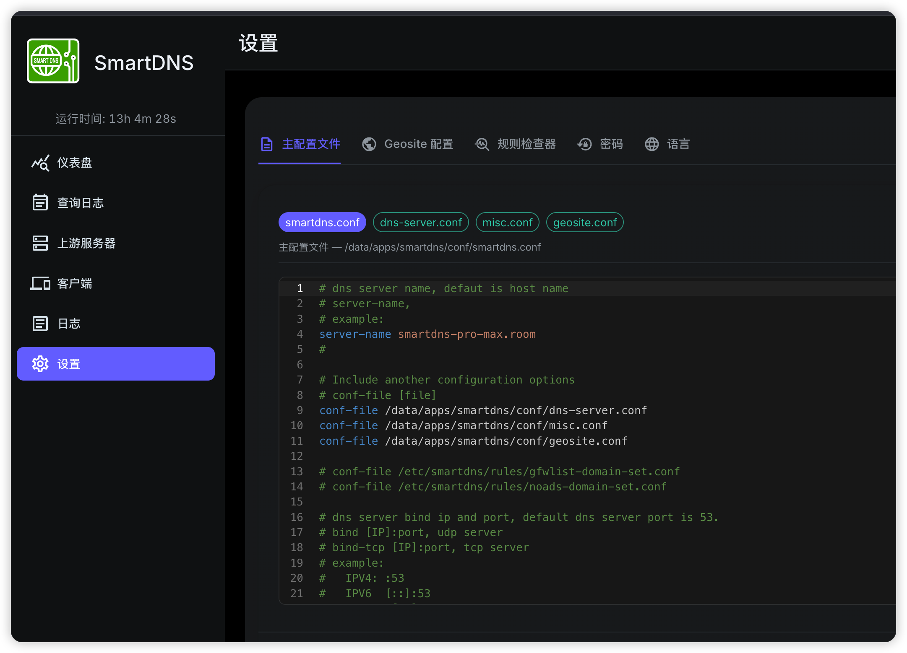

# SmartDNS Pro Max

**English** | [中文](ReadMe.md)

**An enhanced fork of [pymumu/smartdns](https://github.com/pymumu/smartdns)** — building on the upstream's fast DNS-based traffic splitting, it completes the full geosite domain-list management loop and adds a brand-new rule-chain diagnostic tool.

<p align="center"></p>

SmartDNS is a local DNS server that accepts DNS query requests from local clients, fetches results from multiple upstream DNS servers, and returns the IP with the fastest access speed to the client. It also supports mapping specific domains to fixed IPs for ad filtering, and supports secure DNS protocols such as DoT / DoH / DoQ / DoH3 for better privacy.

On top of the upstream, this fork adds:

| Feature | Description |
| --- | --- |
| **Geosite domain routing** | Full `geosite-dat` domain-list support: automatic download, change detection, hot reload, WebUI management |
| **Rule-chain diagnostics** | Original `--check-domain-rule` CLI and WebUI rule inspector — see at a glance which rule a domain hits and which servers it queries |
| **Online config editing** | Edit main and sub configuration files directly in the WebUI, with multi-file switching |
| **Stability fixes** | Fixes real crashes: TCP ping use-after-free, fast_ping race condition, geosite reload crash, etc. |
| **Multi-arch Docker** | Rebuilt build pipeline with amd64 / arm64 runtime images and a dev/debug image |

---

## Highlights

### 1. Geosite Domain Routing

Introduce domain-list files (local lists or remote URLs) via the `geosite-dat` directive and route traffic by category:

```conf
# Sub-config geosite.conf
geosite-updater 21600 --data-dir /data/apps/smartdns/data --diff-algo crc32 \
    --http-use-etag yes --http-timeout 10 --http-retry 3 --http-retry-interval 3

geosite-dat gfw      https://raw.githubusercontent.com/MetaCubeX/meta-rules-dat/meta/geo/geosite/gfw.list
geosite-dat netflix  https://raw.githubusercontent.com/MetaCubeX/meta-rules-dat/meta/geo/geosite/netflix.list
geosite-dat openai   https://raw.githubusercontent.com/MetaCubeX/meta-rules-dat/meta/geo/geosite/openai.list
geosite-dat ads      https://raw.githubusercontent.com/MetaCubeX/meta-rules-dat/meta/geo/geosite/category-ads-all.list
geosite-dat apple    https://raw.githubusercontent.com/MetaCubeX/meta-rules-dat/meta/geo/geosite/apple.list
geosite-dat site-ctc site-ctc.list
```

- **Automatic updates**: `geosite-updater` periodically downloads remote lists and detects changes via ETag / mtime / crc32 / md5, skipping reloads when nothing changed
- **Hot reload**: list changes take effect immediately, no service restart required
- **Sub-config aware**: geosite directives in the main config and in any `conf-file` sub-configs all take effect
- **WebUI management**: visually browse each geosite data file — content, line count, and last-update time



Geosite configuration in the main config file editor:



### 2. Rule-Chain Diagnostics (Rule Inspector)

The most common troubleshooting question — "why did this domain take this route?" — now has a direct answer.

**CLI** (JSON output, script-friendly):

```shell
/usr/sbin/smartdns --check-domain-rule www.google.com -c /etc/smartdns/smartdns.conf
```

**WebUI**: enter a domain in "Settings → Rule Inspector" to see the complete rule-matching chain:

- Matched rule IDs and actions (NAMESERVER / IPSET / NFTSET, etc.)
- Cache status (HIT / MISS)
- Server groups and every upstream server in each group
- Real query results per server: status code, CNAME chain, returned IP list
- Results displayed per `response-mode` (FIRST_PING_IP / FASTEST_RESPONSE), with full IPv6 server support



### 3. Online Config Editing in WebUI

Beyond the dashboard, query log, and upstream servers, the settings page now includes a config file editor: switch between and edit `smartdns.conf`, `dns-server.conf`, `misc.conf`, and `geosite.conf`, with changes taking effect on save.



### 4. Stability Fixes

This fork fixes several crashes and race conditions present upstream:

- **TCP ping use-after-free**: `speed-check-mode` with `tcp:443` could trigger UAF crashes — fixed, with the default speed-check strategy adjusted
- **fast_ping race condition**: fixed the race between ping shutdown notification and event draining
- **geosite reload crash**: config reload could replay a garbled argv due to `getopt_long_only` reordering — fixed with argument-copy protection
- **HTTP/2 memory safety**: merged and tracked upstream HPACK / HTTP2 stream UAF fixes

### 5. Multi-Arch Docker Builds

- `amd64` / `arm64` runtime and builder images
- `smartdns-dev` development/debug image (gdb, strace, vim included)
- Custom dependencies via `LOCAL_DEPS_PREFIX` (e.g. `/opt`)
- Static OpenSSL / Curl linking; static release support for the plugin

---

## Upstream Core Features

The following capabilities are inherited from upstream [pymumu/smartdns](https://github.com/pymumu/smartdns):

- **Multiple virtual DNS servers**: independent ports, rules, and clients
- **Concurrent multi-upstream queries**: no single point of failure
- **Fastest IP return**: speed-tests resolved IPs and returns the fastest one
- **Multiple protocols**: UDP / TCP / DoT / DoH / DoQ / DoH3, non-53 ports, socks5 / HTTP proxy
- **High-performance domain suffix matching**: filtering 200k records in < 1ms
- **Domain routing**: different domains query different upstreams, with ipset / nftset support (this fork extends to multiple targets per domain)
- **Per-client control**: parental controls based on MAC / IP
- **IPv4 / IPv6 dual stack** and **DNS64**
- **Multi-platform**: Raspberry Pi, OpenWrt, ASUS routers, WSL

## Architecture

<p align="center"></p>

1. SmartDNS receives DNS query requests from local network devices (PCs, phones);
2. Queries are sent to multiple upstream DNS servers (with geosite-based routing);
3. Once upstreams return the IP lists, SmartDNS detects the server IP with the fastest local access speed;
4. The fastest IP is returned to the local client.

## Build

**Local build**:

```shell
make
```

**Docker build** (recommended, multi-arch):

```shell
# amd64
docker build -t smartdns:amd64 .

# arm64
docker build -f Dockerfile.arm64 -t smartdns:arm64 .
```

SmartDNS also provides packaging scripts (`package/build-pkg.sh`) for LuCI, Debian, OpenWrt, and Optware packages.

**WebUI**: the companion WebUI frontend lives in the separate repo [onion83/smartdns-webui](https://github.com/onion83/smartdns-webui); the in-plugin source is under [smartdns-ui plugin](plugin/smartdns-ui/), built with Next.js (`npm run build`).

## Documentation

- [Design Intent and Development History](doc/design-and-history_en.md) ([中文](doc/design-and-history.md)) — design goals, architecture layers, major development history, and pitfalls solved in this fork
- [Geosite Configuration Guide](doc/geosite-config_en.md) ([中文](doc/geosite-config.md)) — full syntax and parameters of `geosite-updater` / `geosite-dat` / `geosite-set` / `domain-rules`

## Upstream Documentation

For full configuration documentation, see the upstream site: [https://pymumu.github.io/smartdns](https://pymumu.github.io/smartdns)

## Acknowledgements

This project is based on upstream [pymumu/smartdns](https://github.com/pymumu/smartdns). Thanks to the original author [@nickpeng](https://github.com/pymumu) and all upstream contributors.

## License

SmartDNS is open source under the GPL V3 license.
